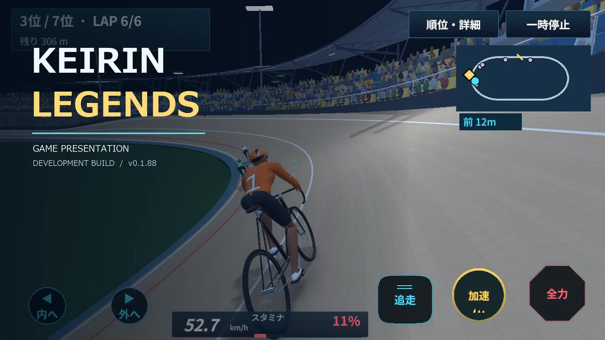
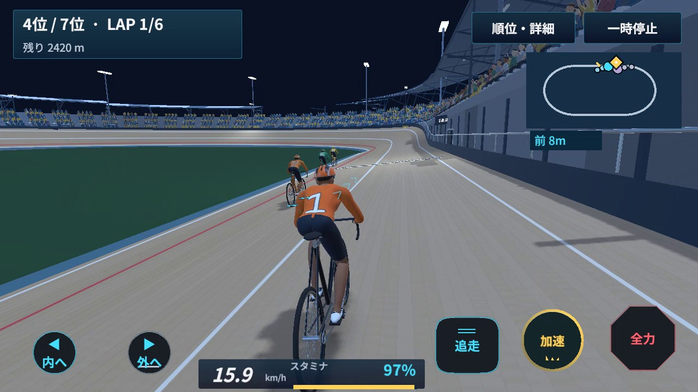
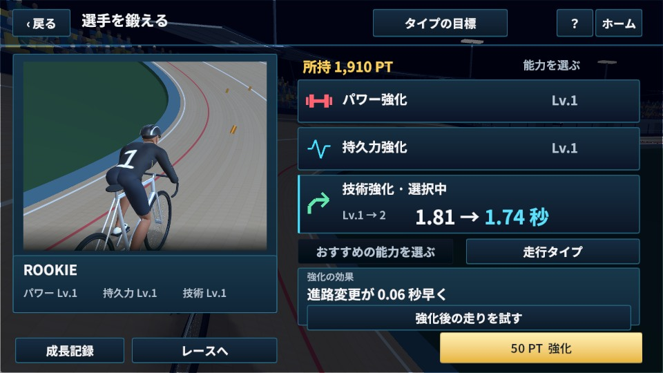
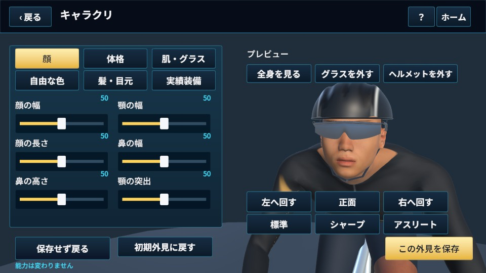
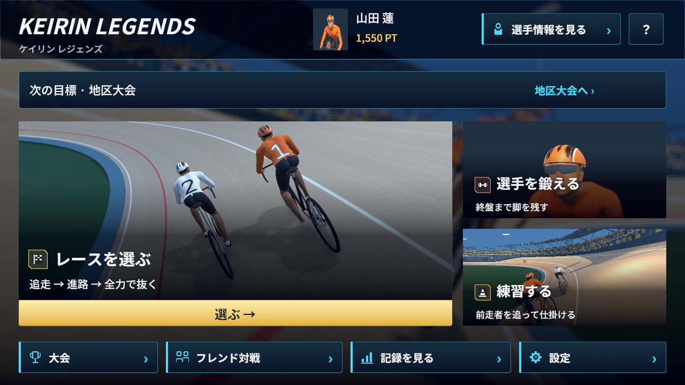

# KEIRIN LEGENDS

**育てた選手で、狙った瞬間に抜く。**

追走で脚をため、進路を選び、全力で仕掛ける。競輪ならではの位置取りとスタミナ管理を、選手育成につなぐ3Dレースゲームです。

[▶ 90秒の紹介動画を見る・ダウンロード（60fps）](https://github.com/TYTanaka/KEIRIN-LEGENDS-Showcase/releases/download/v0.1.88/KEIRIN-LEGENDS-v0.1.88-Presentation-90s-720p60.mp4)　｜　[Windows開発版をダウンロード](https://github.com/TYTanaka/KEIRIN-LEGENDS-Showcase/releases/tag/v0.1.88)　｜　[遊び方](PLAYING.md)

> **開発中のWindows試遊版 v0.1.88。** このリポジトリでは紹介資料と配布版を公開しています。ゲームのソースコードは非公開です。Android実機評価・常設オンライン運営・公開ランク戦は未完了です。

## このゲームの面白さ

### 追走 → 進路 → 全力

前走者の風よけを使って脚を残し、空いた進路へ移動。仕掛けるタイミングと、ゴールまで残すスタミナを自分で判断します。加速し続けるだけでは勝てない駆け引きが中心です。

### 育てた効果を、走って確かめる

パワー・持久力・技術を育成。必要PTと強化効果を確認してから選び、強化前後の走りを同じ条件のゴースト比較で確かめられます。

### 自分の選手で、次の目標へ

顔の輪郭・体格・髪・目元・装備の色を調整。通常レース、3戦制大会、短距離の腕試し、週替わりの同条件レース、練習、記録・リプレイを用意しています。

| 遊び | 内容 |
|---|---|
| 通常レース | 育てた選手で7車のレース。完走して育成PTを獲得 |
| 育成 | パワー・持久力・技術を強化。変化を比較試走で確認 |
| 大会 | 全3戦の合計点で総合順位を競う |
| 短いレース | 1対1、スプリント、追い上げ |
| 週替わり | 共通能力・同条件で記録に挑戦。公開オンラインランキングとは別 |
| 練習・リプレイ | 操作を練習し、実際の走行記録を振り返る |

## 技術と現在の到達点

Unity 6 / C# / uGUIで開発。レース計算・表示・保存を分け、選手の体格や姿勢と、手・ハンドル、靴・ペダルの接触を共通の仕組みで扱っています。

| 対象 | 現在の状態 |
|---|---|
| Windows | 開発版を配布。通常レース・育成・大会などはオフラインで利用可能 |
| 7人通信 | Photon Fusionによる同一Windows PC上の7クライアント＋専用プロセスで検証 |
| 結果保存 | 着順・タイム一致、再接続、API復旧後の一度だけの反映、中断試合の加点なしを検証 |
| Android・別回線 | 実機操作、発熱、別PC・別回線での人による操作評価は未実施 |
| 公開オンライン | 常設サーバー、一般向けランク戦、トップ500、自動マッチング、クラブは未完成／未公開 |

Windows版に対戦用メニューはありますが、公開の常設対戦サービスは稼働していません。ダウンロードだけで常時7人対戦に参加できる版ではありません。

## ダウンロードと動画

企業向けに、追走から抜く場面・育成・キャラクリ・通信技術を**90秒**で紹介する動画を用意しました。ナレーション・説明字幕なしで、口頭説明にも使えます。[3分30秒の詳細版](https://github.com/TYTanaka/KEIRIN-LEGENDS-Showcase/releases/download/v0.1.88/KEIRIN-LEGENDS-v0.1.88-Presentation-720p60.mp4)も残しています。

**[最新版の配布ページ](https://github.com/TYTanaka/KEIRIN-LEGENDS-Showcase/releases/tag/v0.1.88)**

- `KEIRIN-LEGENDS-v0.1.88-Unity-Windows.zip`：Windows 64bit開発版。ZIP全体を展開し、`KEIRIN-LEGENDS.exe`を起動。Unityのインストールは不要です。
- `KEIRIN-LEGENDS-v0.1.88-Presentation-90s-720p60.mp4`：90秒の企業向け紹介・BGM付き。
- `KEIRIN-LEGENDS-v0.1.88-Presentation-90s-Silent-1080p60.mp4`：90秒の口頭説明用・音声なし。
- `KEIRIN-LEGENDS-v0.1.88-Presentation-90s-1080p60.mp4`：90秒の高画質版・BGM付き。
- `KEIRIN-LEGENDS-v0.1.88-Presentation-720p60.mp4`：3分30秒の詳細版。企業名・ナレーション・説明字幕なし。BGM付き。
- `KEIRIN-LEGENDS-v0.1.88-Presentation-Silent-1080p60.mp4`：口頭説明用の音声なし動画。
- `SHA256SUMS.txt`：配布ファイルの確認用ハッシュ。

動画の動くゲーム部分は専用デモデータと撮影用の通常入力で60fps収録しています。動画用に上部ヒントを非表示にしました。通常のチュートリアルは維持しています。通信の静止画・構成図はv0.1.86の同一PC検証資料です。収録設定は対象端末の実測FPSや性能保証ではありません。

## フィードバック

不具合や分かりにくい点は[Issues](https://github.com/TYTanaka/KEIRIN-LEGENDS-Showcase/issues)へ。使用環境、操作、期待した結果、実際に起きたことを添えてください。提案・開発上の相談も受け付けています。利用・提携を約束する告知ではありません。

[データ・通信について](PRIVACY.md) ／ [権利と第三者素材](RIGHTS.md) ／ [更新内容](CHANGELOG.md)
